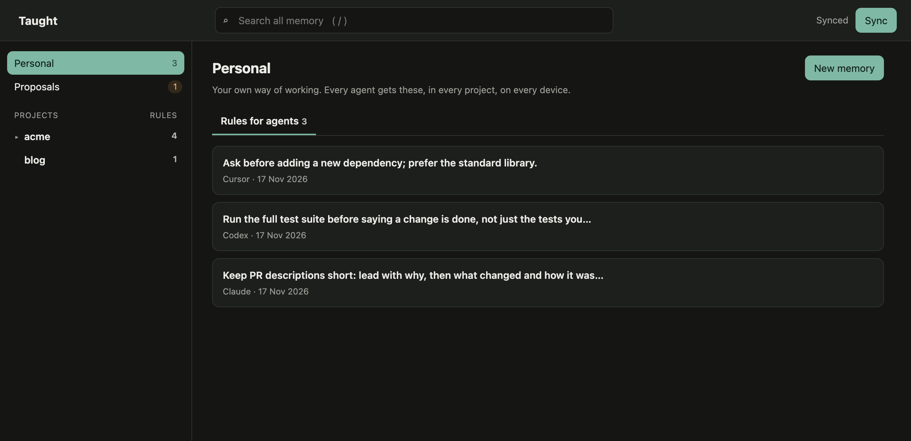
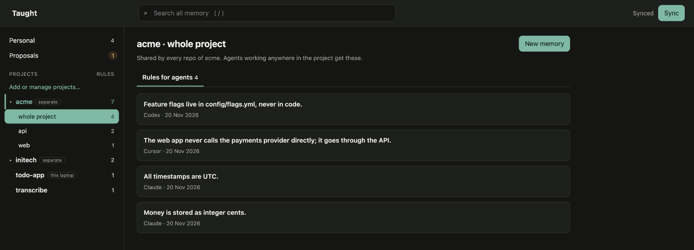
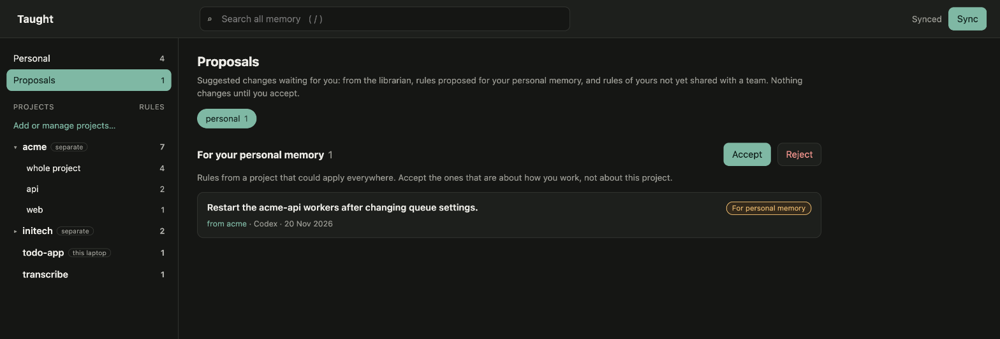

# Getting started with Taught (beta)

**Correct one agent once. Every agent on every machine remembers.**

You tell Claude Code "we never call the payments API from the frontend". Tomorrow Codex, on your other laptop, already knows. Taught keeps what you teach your coding agents in a private git repo you own, and writes it into the files each agent already reads.

This page takes about 10 minutes: install, a first test, a second device, and what to tell us.

## What you need

- macOS (Linux works, but the background sync is macOS-only for now).
- Node 20 or newer, and git.
- At least one of: Claude Code, Codex, Cursor, Antigravity or Gemini CLI.
- An **empty private GitHub repo** for your memory, for example `you/taught-memory`. Create it now, with no README. Your memory lives there, and only people with access to it can read it. Don't share it with anyone: Taught has no accounts, so anyone with access to this repo is treated as you.
  - **Using Taught for work?** You can create this repo in your company's GitHub org instead, for example `company/taught-yourname`, so company knowledge stays on company accounts. Each person still needs their own repo. Taught doesn't share memory between people yet.

## 1. Install and set up (5 minutes)

```bash
npm i -g https://github.com/ajeetsk/taught-releases/releases/latest/download/taught.tgz

taught setup --remote git@github.com:you/taught-memory.git --repos ~/code
```

- `--remote`: your memory repo. Use the same form (SSH or https) you use with `git clone`.
- `--repos`: the folders that hold your code checkouts. You can list several (`--repos ~/code ~/work`). If you leave it out, Taught looks in `~/Repos`.

Setup works through these steps and prints a line for each:

| Step | What it does |
|---|---|
| Memory tree | Clones your memory repo into `~/.taught` |
| Your code on this device | Finds your repos and groups them into projects (below) |
| Claude Code hooks | So Claude syncs when a session starts and when it saves a memory |
| Background sync | Every 5 minutes and at login (macOS) |
| First sync | Imports what Claude Code already remembers on this machine, then writes every agent's files |

Then check it:

```bash
taught doctor
```

Every line should be ✓, or · (information only). If something shows ✗, it says what to run.

**How your repos become projects.** Repos in one folder whose names contain the folder's name form one project: `~/code/acme/acme-api` and `~/code/acme/acme-web` become project `acme`. Every other repo is its own project. Wrong grouping? Fix it with:

```bash
taught project add <name> --from <folder>   # make the repos in a folder one project
taught project remove <name>
```

## 2. Try it (2 minutes)

1. Open a repo in Claude Code (or Codex) and correct it about something lasting, the way you normally would. For example: "In this project, all dates are stored in UTC. Remember that."
2. The agent records it by running `taught note …`. Its own instructions, which Taught wrote, tell it to. You'll see the command and a line starting with `Noted (…)`.
3. Start a **new** session of a **different** agent in the same repo, and ask: "How do we store dates here?"

It should answer from the rule. Agents read their instructions when a session starts, so an already-open session won't see the rule until you restart it.

If the agent didn't record the rule, say "record that with taught note". Or record it yourself, from the repo:

```bash
taught note "All dates are stored in UTC." --why "mixed time zones broke the reports"
```

Then run `taught ui` to see the rule, which agent recorded it and when (see [Manage memory in the UI](#manage-memory-in-the-ui)).

## 3. Add your other laptop

On the second machine, install Taught, then run the same setup with the **same memory repo**:

```bash
npm i -g https://github.com/ajeetsk/taught-releases/releases/latest/download/taught.tgz
taught setup --remote <the same memory repo> --repos <where your code is on this machine>
```

Folder layouts don't have to match. Taught recognises a repo by its git remote, not its path, and SSH and https clones of the same repo count as one repo.

A rule recorded on one laptop reaches the other within about 5 minutes. To check, record a rule on laptop A, wait, then on laptop B start a new agent session in that project and ask about it.

## Where a rule goes

When an agent records a rule, it chooses a level:

| Level | Reaches | Example |
|---|---|---|
| **personal** | every agent, in every project | "Keep PR descriptions short; lead with why." |
| **project** (the default) | agents working in any repo of that project | "All dates are stored in UTC." |
| **repo** | agents working in that one repo | "Run `make migrate-check` before committing a migration." |

**Your code repos stay clean.** Project memory goes in the folder that holds the project's repos. If a repo has no such folder, its memory goes into files Taught creates inside the repo, and git is told to ignore them: `git status` stays clean and nothing gets committed. Taught never edits a file it didn't create.

**Client details don't leak into personal memory.** A personal rule an agent records inside a project goes to personal memory only if it names nothing from that project. If it mentions the project's or its repos' names, a file path or a code identifier, it is held for your review:

```bash
taught review                  # what's waiting
taught review accept <id>
taught review edit <id>        # rewrite it generically first
taught review reject <id>      # keep it in its project only
```

The same list is in `taught ui`.

## Your agents

| Agent | What it gets | Anything to do? |
|---|---|---|
| **Claude Code** | Personal, project and repo memory. It records corrections itself, and Taught imports Claude's own memories. | Nothing. |
| **Codex** | Personal, project and repo memory. It records corrections with `taught note`. | Nothing. Codex's sandbox can't write the memory folder, so a note is queued and filed by the next background sync. |
| **Cursor** | Project and repo memory, through rule files in the repos it opens. | For personal memory too, add Taught as an MCP server in `~/.cursor/mcp.json`: `{ "mcpServers": { "taught": { "command": "taught", "args": ["mcp"] } } }` |
| **Antigravity** | Personal memory in `~/.gemini/GEMINI.md`, and project memory through the `AGENTS.md` in your project folder. | Nothing. |
| **Gemini CLI** | Personal memory in `~/.gemini/GEMINI.md`. | **Untested.** Gemini CLI reads only `GEMINI.md` by default, so project memory needs it set to read `AGENTS.md` too. Please tell us what you see. |
| **Any other agent** | Project memory, if it reads `AGENTS.md`. | Or connect it to `taught mcp` (`recall` and `note` tools). |

Installing an agent later is fine: the next sync covers it.

## Manage memory in the UI

```bash
taught ui
```

This opens a page in your browser. It runs only on your machine (`127.0.0.1`), behind a one-time link that `taught ui` prints.

**Personal:** rules every agent gets, in every project. Each one shows which agent recorded it and when.



**Projects:** each project, with *whole project* rules and each repo's own rules. Click a rule to read why it exists, edit it or delete it. **New memory** adds one by hand.



**Proposals:** everything waiting for you. That means personal rules held because they mention a project, and the librarian's suggested merges and cleanups. Nothing changes until you accept.



Other things to know:
- **Search** (press `/`) looks across all memory.
- **Edit** saves a new version; the old one stays in history.
- **Delete** stops agents from getting the rule; it also stays in history.
- **Sync** (top right) sends your changes to your other devices and updates every agent's files. Without it, the background sync does it within 5 minutes.

## Optional: tidying memory with the librarian

Over time memory picks up duplicates, rules that contradict each other, and one-off facts. The librarian is an AI agent that reads your memory and suggests merges and cleanups. Its suggestions appear under **Proposals**, and nothing changes until you accept them.

**It needs no API key.** Taught has no AI model of its own. The librarian runs on a coding agent you already use, signed in as you, the way you use it every day. Pick whichever suits you:

| How | Set up | Paid through |
|---|---|---|
| **In your session.** Your agent does the work while you watch. | None. Ask your agent: "Run `taught librarian next` and follow its instructions until it says there's nothing left." Agents connected through `taught mcp` use its `librarian_next` and `librarian_answer` tools instead. | Your plan with that agent |
| **From the command line**, through an installed agent (Claude Code, Codex, Cursor or Gemini CLI) | `taught librarian setup` picks the first one installed (or choose one with `--route cli:codex`) and sends a test request. Then `taught librarian run` shows what it would send, and `taught librarian run --yes` sends it. | Your plan with that agent |
| **Your own Anthropic API key** | `taught librarian key set anthropic` (stored in the macOS Keychain, never in your memory), then `taught librarian setup --route api:anthropic` | Your API account. `run` shows an estimated cost before sending. |
| **Any other model**: another provider, a local model, your company's gateway | `taught librarian setup --route cli:custom --command '<your command>'`. The command reads the request on stdin and prints JSON. | Whatever that command uses |

From the command line, each agent runs in an empty temporary folder, read-only, and never sees your code.

**Choose which projects it may read.** Sending a project's memory to a model is opt-in, per project, so client memory never goes out unless you say so:

```bash
taught project policy acme --librarian cli       # in a session, or through an agent's command line
taught project policy acme --librarian cli,api   # also through your own API key
taught project policy personal --librarian cli   # your personal memory
```

The setting syncs to your other devices. Until a project allows it, the librarian leaves that project alone and says so.

## Everyday commands

```bash
taught ui         # browse, edit, delete and review memory
taught status     # last sync, anything queued or waiting
taught sync       # sync now instead of waiting up to 5 minutes
taught doctor     # health check
```

## Update and uninstall

Update by running the install command again. `taught --version` shows the version you have.

```bash
npm i -g https://github.com/ajeetsk/taught-releases/releases/latest/download/taught.tgz
```

Uninstall:

```bash
taught uninstall          # shows what it would remove
taught uninstall --yes    # removes everything Taught wrote; your memory repo is kept
npm uninstall -g taught
```

Before Taught first changes a file of yours, it keeps a copy in `~/.taught-local/backups/`.

## Privacy

- Your memory stays on your machines and in your own private repo.
- Taught sends nothing anywhere else: no telemetry, no server.
- The librarian is the only thing that shows memory to a model, and only when you run it. It goes to the agent you chose.

## Tell us how it went

This is what the beta is for. Post on the [issues page](https://github.com/ajeetsk/taught-releases/issues/new/choose). It has two forms: **Something went wrong** and **Feedback**. Most useful to us:

1. **Did a correction reach another agent or laptop?** What did you teach, and where did it show up (or not)?
2. **Anything confusing in setup**, or anything Taught did that you didn't expect.
3. **Which agents you use**, especially Cursor, Antigravity or Gemini CLI.
4. **After a week:** is your memory useful, or noisy? Did an agent act on an old or wrong rule?

When something goes wrong, run:

```bash
taught feedback
```

It copies a setup report to your clipboard: versions and checks, never your memory, and with any password or token in a URL hidden. Paste it into the form.

**Issues are public.** Describe your rules and projects generically ("a rule about our API", "a work repo"). Don't paste memory content, client names or private repo names.

This is an invite-only beta: you may share it with people on your own team, but not beyond. See [TERMS.md](TERMS.md).
