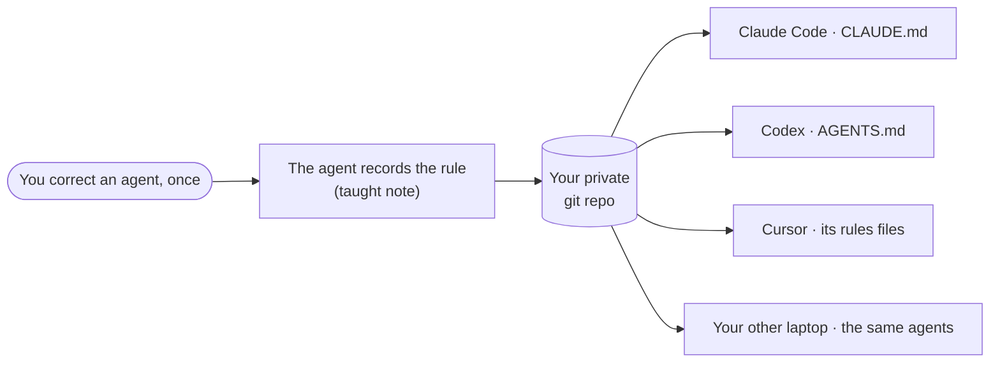
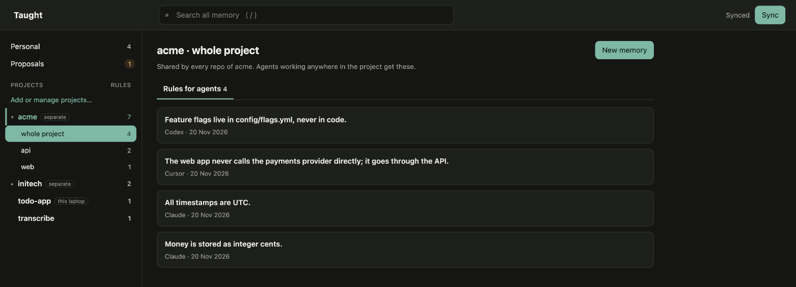

<p align="center">
  
</p>

<h1 align="center">Taught: shared memory for Claude Code, Codex, Cursor and Antigravity</h1>

<p align="center">
  <a href="https://www.npmjs.com/package/taught"></a>
  
  
</p>

<p align="center"><strong>Correct one agent once. Every agent on every machine remembers.</strong></p>

<p align="center">
  The rules you teach Claude Code, Codex, Cursor and Antigravity,<br>
  kept in a private git repo you own and given to all of them, on every laptop.
</p>

<p align="center"><em>For developers who work with more than one coding agent, on more than one laptop, or for more than one client.</em></p>

<p align="center">
  <a href="GETTING-STARTED.md"><strong>Getting started</strong></a> ·
  <a href="FAQ.md">FAQ</a> ·
  <a href="https://github.com/AryabhattaLabs/taught/releases">Releases</a> ·
  <a href="https://github.com/AryabhattaLabs/taught/issues/new/choose">Feedback</a>
</p>

<p align="center"><sub>Free beta · macOS · rules, not chat history · your own repo, no Taught account · no telemetry</sub></p>

<p align="center">
  
</p>

> You tell Claude Code: "we never call the payments API from the frontend."<br>
> The next morning, Codex does it anyway.<br>
> On your other laptop, Claude Code has never heard of it.

Each agent keeps its own memory, on one machine. So you teach the same thing again for each agent, and again on each laptop. With Taught you say it once. The agent records it as a rule, and your other agents and laptops have it within minutes.

## Try it

You need macOS, Node 20+, git, and an empty **private** GitHub repo for your memory (for example `you/taught-memory`).

```bash
npm i -g taught
taught setup --remote git@github.com:you/taught-memory.git
taught doctor
```

`taught setup` joins (or starts) your memory repo, finds your code folders, adds Claude Code hooks, starts a background sync and syncs once. It registers nothing by itself: it ends on the **Projects** page of `taught ui`, where you choose which code Taught keeps memory for and where that memory is kept (your memory repo, this laptop only, a separate git repo, or Off). For work, the memory repo can be a private repo in your company's GitHub org, one per person.

Then see it work, in two minutes:

1. In one of your repos, correct an agent about something lasting: "In this project, all dates are stored in UTC. Remember that."
2. The agent records it with `taught note`. You'll see a line starting with `Noted (…)`.
3. Start a new session of a **different** agent in the same repo and ask: "How do we store dates here?"

On a second laptop, run the same `setup` with the same memory repo. The full walk-through is in [Getting started](GETTING-STARTED.md).

## How a rule travels



Taught keeps **rules, not conversations**. A rule is something you want followed from now on: a correction, a way you like work done, a project's convention. What an agent said and read in a session (its context and chat history) stays with that agent.

It is not a hosted service either: there is no Taught server and no account. Underneath it is git, and a repo that is yours.

## What you get

- **One memory for all your agents.** Teach Claude Code something, and Codex and Cursor know it too.
- **The same rules on every laptop.** On a new laptop, one setup command brings them all.
- **Your habits follow you into every project.** A correction about how you work (how you like PRs, tests or commit messages) becomes a personal rule, and applies everywhere, not only in the project where you said it.
- **A client's rules stay with that client.** Each project's rules stay with that project. A client's memory can live in its own private repo, or on one laptop only.
- **Your other open sessions hear about it.** With Claude Code, a rule recorded in one session reaches your other open sessions at their next prompt.
- **What Claude Code has already saved comes along.** Taught brings its saved memories in, so you don't start from nothing.
- **A backup with history.** Every rule is a file in your own private git repo. Edit or delete one, and the old version is still there.
- **For a team, shared rules with an optional review.** See [For a team](#for-a-team).

**One agent, on one laptop?** Still useful. Your personal rules, your open sessions, what Claude Code has saved and the backup need nothing more.

## One page for everything your agents have learned

`taught ui` opens a page that runs only on your machine. It shows every rule, by project, with which agent recorded it and when. Edit or delete any of them; the old version stays in history.



## Why not…

| Instead of Taught | What you would be missing |
|---|---|
| **Your own git repo and a cron job** | Underneath, that is what Taught is. It adds the work around the sync: the agent records the rule itself, one rule is written into every agent's file, and your personal rules are kept apart from each project's. [More](FAQ.md#why-not-my-own-git-repo-and-a-cron-job) |
| **Committing `CLAUDE.md` or `AGENTS.md`** | Keep doing that for what your team has agreed on. Taught is for what doesn't fit there: personal rules, corrections made in the middle of a task, projects made of several repos, and memory that must not be in the code repo. It never touches a committed file. [More](FAQ.md#why-not-commit-claudemd-or-agentsmd-to-the-code-repo) |
| **Each agent's own memory** | That stays with one agent on one machine. Taught gives every agent the same rules on every device, and brings in what Claude Code has already saved. [More](FAQ.md#doesnt-each-agent-have-its-own-memory) |

## Yours, and easy to undo

- **Your memory is plain markdown in your own private git repo**, one file per rule, readable without Taught.
- **Nothing about you, your code or your memory is sent anywhere else. No telemetry.** Once a day, Taught fetches one small public file from this repo's releases to learn whether a newer version exists. Nothing from your machine is sent with that request, and `taught update-check off` turns it off.
- **Your code repos stay clean.** Inside a repo, Taught writes only files it creates, and tells git to ignore them. A committed `AGENTS.md` or `CLAUDE.md` is never touched.
- **`taught uninstall` takes it all back out**, and keeps your memory repo.

<details>
<summary><strong>Exactly what Taught changes on your machine</strong></summary>

<br>

- A block between `<!-- taught:begin … -->` markers in `~/.claude/CLAUDE.md`, `~/.codex/AGENTS.md` and `~/.gemini/GEMINI.md`. Nothing outside the markers is touched; a copy of each file as it was is kept in `~/.taught-local/backups/`.
- In a folder that holds a project's repos: the same kind of block in `CLAUDE.md` and `AGENTS.md`.
- Inside your repos: only files Taught creates (`AGENTS.md`, `CLAUDE.local.md`, `.cursor/rules/taught*.mdc`), each listed in that repo's `.git/info/exclude`, so they never show up in `git status` or a commit. A repo's own committed `AGENTS.md` is never touched.
- Three Claude Code hooks in `~/.claude/settings.json` (sync when a session starts, sync when Claude saves a memory, and tell an open session about memory that changed), and a background job (`~/Library/LaunchAgents/dev.taught.sync.plist`).
- Your memory lives in `~/.taught` and your memory repo, plus anything you keep on this laptop only or in a separate location you attach (`~/.taught-local`). Nothing about you, your code or your memory is sent anywhere else. No telemetry.
- Once a day, Taught asks GitHub whether a newer version exists, by fetching one small public file from this repo's releases. Nothing from your machine is sent with that request. GitHub's download count for that file is the only usage figure Taught's author gets: roughly how many devices run it. Turn it off on a device with `taught update-check off`.
- In a repo you set to **Off**, Taught writes nothing at all.

</details>

## For a team

A team shares a project's **rules, guidelines and constraints**, not context. Each person's sessions and personal rules stay their own.

- **One project, one shared repo.** A private git repo that all of you can write to holds that project's rules, and every teammate's agents get them.
- **Nothing of yours is published without your yes.** Removing the project on your laptop doesn't take it from the others.
- **You're told what teammates change**, by name, at your next sync and in `taught ui`.
- **Review, if you want a gate.** An admin of the repo turns it on once. A rule then reaches the others only after an admin approves it, in Taught or as a pull request.

See [Sharing a project's memory with your team](GETTING-STARTED.md#sharing-a-projects-memory-with-your-team). Everyone on the team should run the same, latest beta.

## What works today

- **Agents:** Claude Code, Codex, Cursor and Antigravity. Gemini CLI is untested. Any other agent that reads `AGENTS.md` gets project memory.
- **Systems:** macOS is what Taught is built and tested on. Linux is expected to work but is little tested, and Windows is untested.
- **Git hosts:** GitHub, Bitbucket and GitLab. Sync and review have been run on all three. For a review, Taught opens the pull request for you on GitHub; on Bitbucket and GitLab it gives you a link and you create it yourself.

Details are in the [FAQ](FAQ.md#which-agents-systems-and-git-hosts-work).

## Update

Run `npm i -g taught@latest`: it always fetches the latest beta. `taught --version` shows which one you have, and `taught doctor`, `taught status` and a sync you run yourself say when a newer one exists.

```bash
npm i -g taught@latest
```

## Undo

```bash
taught uninstall          # says what it will remove
taught uninstall --yes    # removes it; your memory repo is kept
npm uninstall -g taught
```

## Feedback

Post on the [issues page](https://github.com/AryabhattaLabs/taught/issues/new/choose). `taught feedback` copies a setup report (versions and checks, never your memory) to paste into the form. Issues are public: describe your rules and projects generically.

This is a free beta, open to anyone: you may share the install link with whoever wants to try it. See [TERMS.md](TERMS.md).
